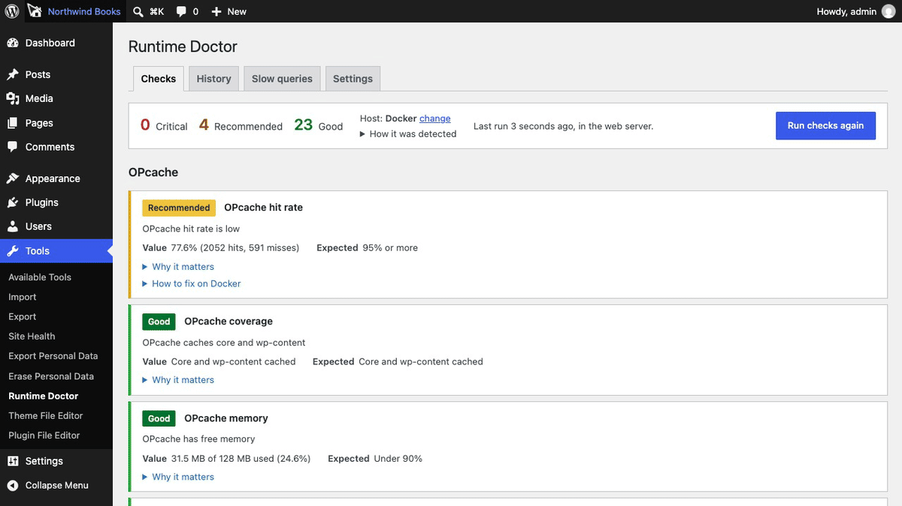
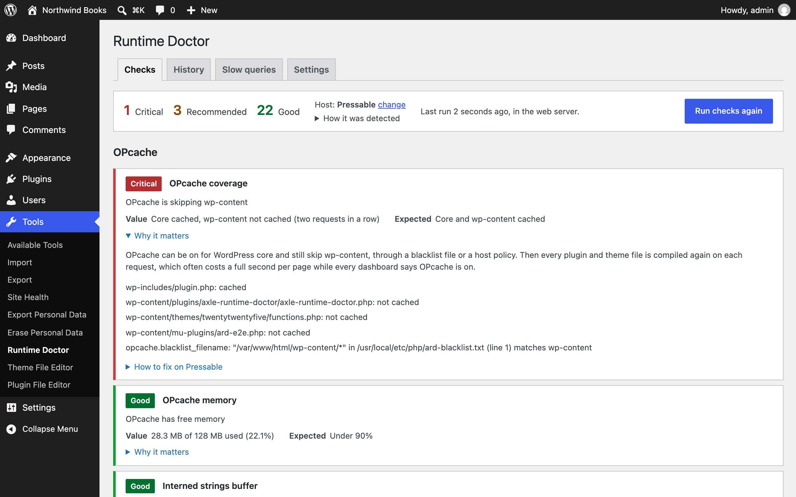
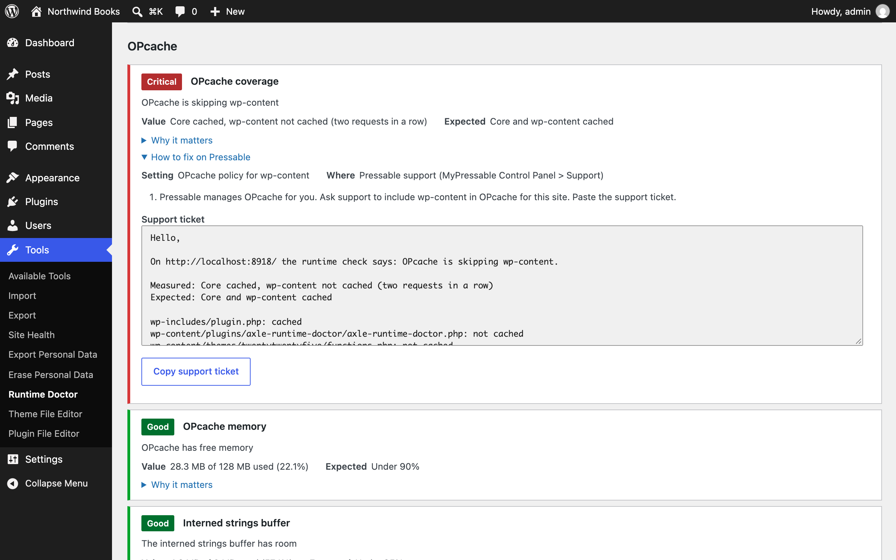
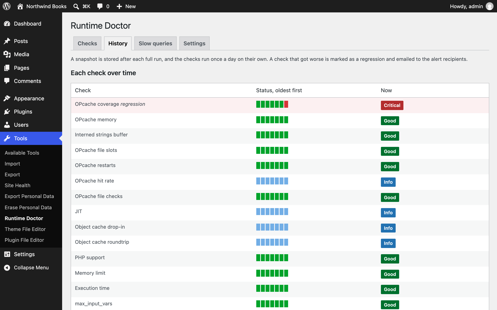
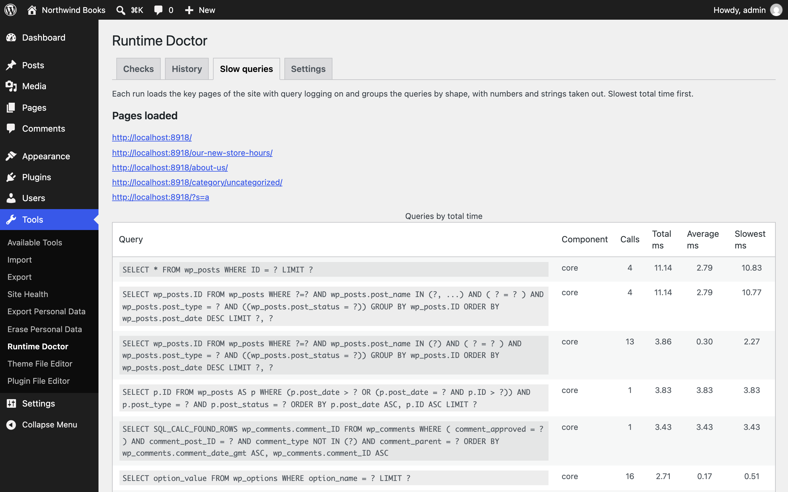

<p align="center"></p>

<h1 align="center">Axle Runtime Doctor</h1>

<p align="center">
  <a href="https://playground.wordpress.net/?blueprint-url=https://raw.githubusercontent.com/aryanjasala/axle-runtime-doctor/main/blueprint.json"></a>
  <a href="https://github.com/aryanjasala/axle-runtime-doctor/releases/latest"></a>
  
  
  <a href="LICENSE.md"></a>
  <br>
  <a href="https://github.com/aryanjasala/axle-runtime-doctor/actions/workflows/phpcs.yml"></a>
  <a href="https://github.com/aryanjasala/axle-runtime-doctor/actions/workflows/phpstan.yml"></a>
  <a href="https://github.com/aryanjasala/axle-runtime-doctor/actions/workflows/unit-tests.yml"></a>
  <a href="https://github.com/aryanjasala/axle-runtime-doctor/actions/workflows/e2e-tests.yml"></a>
  <a href="https://github.com/aryanjasala/axle-runtime-doctor/actions/workflows/plugin-check.yml"></a>
</p>

<p align="center">Find the server settings that slow WordPress down, from inside a real web request, with the fix and a support ticket for your host.</p>

<p align="center">
  
</p>

---

A site is slow and the host says everything is fine. Often the cause is runtime config nobody checks: OPcache skipping wp-content, a Redis drop-in that falls back to memory, a PHP branch with no security fixes, WP-Cron off with no real cron behind it. Site Health says "Opcode cache is enabled" and stops there. Axle Runtime Doctor checks what core does not, inside a real web request, and gives the fix for your host with a support ticket to paste.

> [!NOTE]
> Free and open source under the GPL. No pro version, no upsells, no ads in wp-admin, no tracking. And it stays that way.
>
> Part of Axle by AryanX, a family of plugins for running WordPress sites safely.

## Features

- **OPcache coverage**: asks OPcache about files every request loads, and flags core cached with wp-content skipped, with the reason (blacklist file, `file_cache_only`, `restrict_api`, `.user.ini` or the host). Plus memory, strings, file slots, restarts, hit rate and `validate_timestamps`
- **An object cache that lies**: writes a key in one request and reads it in the next, so a drop-in running on memory because Redis is down shows up. Hit rate from sampled front-end requests
- **PHP**: end of security support for your branch, the patch level against php.net (optional), `memory_limit` against real peak use, `max_input_vars` against your biggest menu, upload limits, `display_errors`
- **Database**: the 20 biggest autoloaded options with owners and a **Turn autoload off** button, autoloaded transients, options of inactive plugins, slow queries on key pages grouped by shape, MyISAM, missing primary keys, MySQL and MariaDB end of life
- **Cron, loopback and files**: `DISABLE_WP_CRON` with nothing running events, duplicate events, loopback through a CDN, PHP in uploads, file owner mismatches, disk space
- **A fix per host**: detects WP Engine, Pressable, Kinsta, WordPress.com, VIP, Pantheon, GoDaddy, Flywheel, SiteGround, Cloudways, Hostinger, cPanel, Plesk, nginx and Apache with the evidence, lets you correct it, and gives the setting, where it lives and a ready-to-paste **support ticket**
- **Web values, not WP-CLI's**: WP-CLI, cron and abilities run the checks through a token-authenticated loopback probe, and say so when it fails
- **History and alerts**: a daily run keeps 30 snapshots, and a check that gets worse sends an email and shows a notice
- Site Health tests and Info, WP-CLI, abilities for AI agents, multisite, and a filter or action for every default and event

## Install

1. Download `axle-runtime-doctor.zip` from the [latest release](https://github.com/aryanjasala/axle-runtime-doctor/releases/latest).
2. In WordPress, go to **Plugins > Add New Plugin > Upload Plugin**, choose the zip and activate it.

Or with WP-CLI:

```sh
wp plugin install https://github.com/aryanjasala/axle-runtime-doctor/releases/latest/download/axle-runtime-doctor.zip --activate
```

Needs WordPress 6.6+ and PHP 7.4+. To try it first, the **Try in WordPress Playground** badge opens a throwaway WordPress in your browser with the plugin and some demo content.

## Quick look

Find out whether OPcache really caches your plugins and theme, from the web server's PHP, not WP-CLI's:

```sh
wp axle-runtime-doctor check --status=critical,recommended
# Ran in the web server (PHP 8.3.14) through the loopback probe. Host: Pressable.
# opcache_coverage  critical  OPcache is skipping wp-content

wp axle-runtime-doctor fix opcache_coverage   # the fix and a support ticket to paste
wp axle-runtime-doctor autoload off my_plugin_cache
```

## Screenshots

<table>
  <tr>
    <td width="50%" valign="top"><br><sub>The checks, with OPcache skipping wp-content and the blacklist that causes it</sub></td>
    <td width="50%" valign="top"><br><sub>How to fix it on Pressable, with the support ticket filled in</sub></td>
  </tr>
  <tr>
    <td width="50%" valign="top"><br><sub>History: the day OPcache stopped caching wp-content</sub></td>
    <td width="50%" valign="top"><br><sub>Slow queries on the key pages, grouped by shape, with the component that sent them</sub></td>
  </tr>
</table>

## Documentation

| Doc | What it covers |
| --- | --- |
| [Reference](docs/REFERENCE.md) | How the checks run, every check, hooks, abilities, WP-CLI, data and privacy |
| [Development](docs/DEVELOPMENT.md) | Local setup, commands and tests |
| [Contributing](docs/CONTRIBUTING.md) | Pull requests, required checks and PR titles |
| [Releasing](docs/RELEASING.md) | How merged pull requests become releases |
| [Security](docs/SECURITY.md) | Reporting a vulnerability |
| [readme.txt](readme.txt) | What WordPress.org shows, with the FAQ and changelog |

## Project structure

```
axle-runtime-doctor.php   plugin header and PSR-4 autoloader
data/
├── fixes.json            the fix and ticket per check and host
├── php-versions.json     PHP branch support dates
└── db-versions.json      MySQL and MariaDB end of life
src/
├── Plugin.php            creates the services
├── Settings.php          settings, thresholds, capability
├── Probe.php             the token-authenticated loopback probe
├── Runner.php            runs checks in the web server
├── Facts.php             reads the runtime, one value at a time
├── Hosts.php             host detection with evidence
├── Fixes.php             fixes and support tickets
├── History.php           snapshots and regressions
├── Alerts.php            regression email and notice
├── Sampler.php           1-in-50 front-end samples
├── Autoload.php          autoloaded options and turning autoload off
├── PhpReleases.php       optional php.net release check
├── Scheduler.php         the daily run
├── Rest.php              REST routes for the screen
├── Abilities.php         abilities for AI agents
├── Privacy.php           exporter, eraser, policy text
├── Checks/               one class per check, plus Context and Registry
├── Admin/                the screen and the regression notice
├── Health/               Site Health tests and Info
└── Cli/                  wp axle-runtime-doctor
assets/                   the screen's CSS and JS
tests/                    PHPUnit (Brain Monkey) and Playwright
```

## More free plugins

Small plugins that each fill one gap in WordPress, all free with no pro version:

| | Plugin | What it does |
| --- | --- | --- |
|  | [Page Template Usage](https://github.com/aryanjasala/page-template-usage) | See which template every page uses, and fix the pages on a missing template |
|  | [Staging Guard](https://github.com/aryanjasala/staging-guard) | Stops staging copies from emailing real people or getting indexed |
|  | [Category & Tag Trash](https://github.com/aryanjasala/category-tag-trash) | A trash for categories, tags and custom terms, with undo and full restore |
|  | [Axle Read-Only Mode](https://github.com/aryanjasala/axle-read-only-mode) | Read-only mode for WordPress during migrations and deploys |
|  | [Restore Blocks from Revisions](https://github.com/aryanjasala/restore-blocks-from-revisions) | Restore a single block from an old revision, not the whole post |
|  | [Activity Log with Undo](https://github.com/aryanjasala/activity-log-with-undo) | An activity log where every change you can reverse has an Undo button |
|  | [Agent Governance](https://github.com/aryanjasala/agent-governance) | Hold risky AI agent calls for approval, preview what they change, and roll back a session |
|  | [Block Doctor](https://github.com/aryanjasala/block-doctor) | Scan the whole site for invalid and broken blocks and fix them in bulk, with undo |
|  | [Block Theme Ops](https://github.com/aryanjasala/block-theme-ops) | Find Site Editor changes that override your theme files, see the diff, reset them or send them to Git |
|  | [Role Right-Sizer](https://github.com/aryanjasala/role-right-sizer) | Recommends the smallest role each user needs, from what they actually do |
|  | [Update Rehearsal](https://github.com/aryanjasala/update-rehearsal) | Try plugin, theme, core and PHP updates on a disposable copy of your site in WordPress Playground first |
|  | [User Session Manager](https://github.com/aryanjasala/user-session-manager) | See every device signed in, sign out one, and limit sessions per role |

## License

Copyright Aryan Jasala. Licensed under [GPL-2.0-or-later](LICENSE.md).
